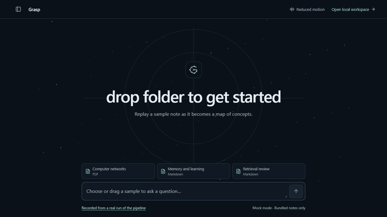
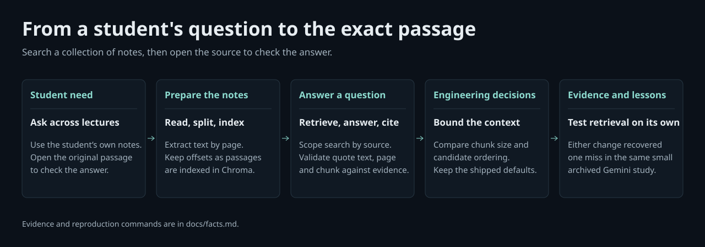
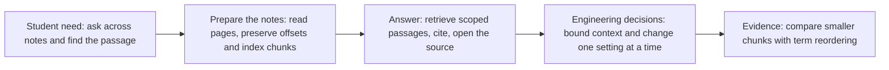
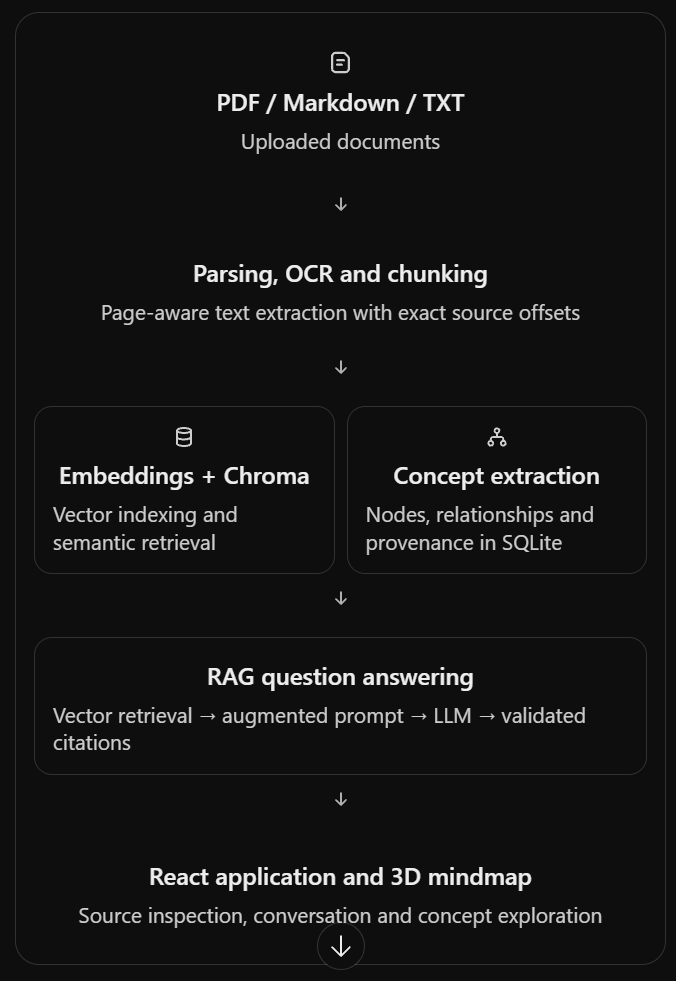
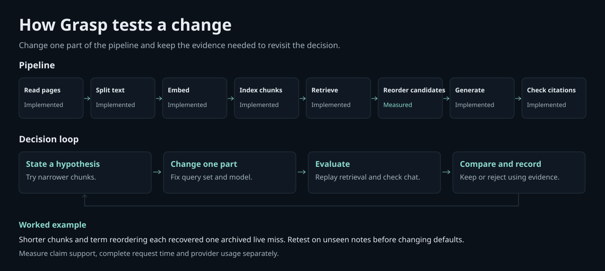
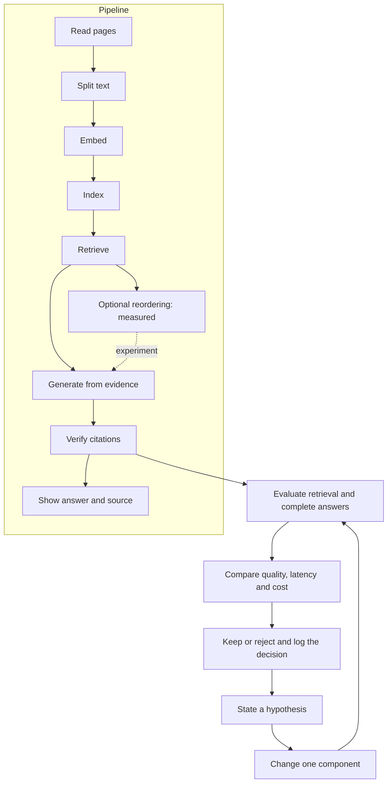

<p align="left"></p>

# Grasp

Ask questions about your notes, see how concepts connect and open the exact passage behind an answer.

[Run the recorded showcase](#run-grasp) · [Interactive walkthrough](#walk-through-rag) · [Evaluation](#4-how-did-i-evaluate-it-and-choose-components)



## 1. How did I build Grasp around student needs? Would a plain LLM be better?

I designed Grasp for repeated questions across a student's own notes, with a way to check each answer against the original passage. A plain LLM is simpler for general explanations, and pasting a short note is often enough for a one-off question.

Retrieval-augmented generation (RAG) looks up relevant passages in an outside knowledge base before asking a language model to answer. In Grasp the knowledge base is the student's notes. The retriever selects passages, and the generator uses those passages as evidence. [Project brief and sources](docs/facts.md#what-the-workspace-does)

| Student need | Design choice | Evidence |
| --- | --- | --- |
| Use the terminology from class | **Implemented** Document scope for questions and follow-ups | [Chat route](apps/api/app/study_routes.py) |
| Check what the note actually says | **Implemented** Exact quote, page and a source view | [Source dialog](apps/web/src/WorkspaceDialogs.tsx) |
| See related ideas and check understanding | **Implemented** Concept links backed by source chunks and a mastery quiz | [Study routes](apps/api/app/study_routes.py) |

### Why not just ask an LLM?

| Question | Plain LLM | Paste notes into long context | Grasp |
| --- | --- | --- | --- |
| Cites your own notes | Needs those notes to be supplied | Can quote text if prompted | Validates quote, page and chunk |
| Unsupported answers | Can give a plausible answer with no course source | Can overlook or misread supplied text | Can miss evidence; a valid quote can still fail to support a claim |
| Cost per question | Not measured yet. Cost depends on provider and prompt | Not measured yet. Longer inputs may cost more | Not measured yet. Live use includes a query embedding and generation |
| Beyond the context window | Lacks access to course notes by itself | Needs a selection or several requests | Searches an index and sends selected passages |
| Setup effort | Open a chat and ask | Collect and paste the relevant notes | Import and index the notes first |
| Privacy | Depends on the service and what you share | The selected service may receive the full pasted note | Mock mode stays local. Live mode sends selected document text during indexing, extraction and questions |

The comparison describes workflows. A controlled answer-quality comparison against either baseline is **Considered** and pending. [Design and comparison limits](docs/rag-design.md)



<details>
<summary>Thought process as Mermaid</summary>



</details>

## 2. How did I weigh cost, speed and quality?

I kept the workspace on bounded vector retrieval and measured chunk size and reordering separately. The recorded runs show differences in retrieval and evidence size. End-to-end latency and billed cost are not measured yet.

### Parse and chunk

| Technique | Status | Cost and speed | Quality and decision |
| --- | --- | --- | --- |
| Local page text and optional OCR | Implemented | OCR adds local CPU work. Time and cost are not measured yet | Page provenance survives. Scans can contain recognition errors |
| Recursive 900-character target, up to 150 overlap | Implemented | Baseline corpus had 8 chunks. Indexing time and cost are not measured yet | Keep as the workspace default |
| Shorter 360/60 setting | Measured | Had 18 chunks and smaller evidence bundles in the experiment | Recovered one archived Gemini miss and lost one hit in mock. Retest before adoption |

### Embed and index

| Technique | Status | Cost and speed | Quality and decision |
| --- | --- | --- | --- |
| Chroma with configured embeddings and SQLite sources | Implemented | Local index with a live-mode embedding request for queries. Storage growth and provider cost are not measured yet | Keep exact text and offsets in SQLite. Re-index when changing embedding spaces |
| Offline hash embeddings | Implemented | No provider charges. Local cost is not measured yet | Deterministic wiring checks and recorded demo |
| Hosted vector database | Considered | Network, hosting and operating cost are not measured yet | Defer until a measured scale or tenancy need justifies it |

### Retrieve and rank

| Technique | Status | Cost and speed | Quality and decision |
| --- | --- | --- | --- |
| Vector search, source filter, up to five passages by default | Implemented | Bounded prompt, with final cost not measured yet | Keep as the workspace baseline |
| Term-overlap reorder | Measured | Sorts the same candidates locally. Adds no model request | Recovered one archived Gemini miss with the default chunk split |
| Hybrid BM25 plus vectors, learned reranker | Considered | Added work and latency are not measured yet | Test only against known misses on held-out notes |

### Generate

| Technique | Status | Cost and speed | Quality and decision |
| --- | --- | --- | --- |
| Structured Gemini or OpenAI generation, one validation retry | Implemented | Retry can add a request. Token use and cost are not measured yet | Require source citations and allow a decline |
| Agentic retrieval or fine-tuning | Considered | Extra model calls or training. Cost is not measured yet | Defer until there is a measured failure a simpler component change cannot address |

### Verify

| Technique | Status | Cost and speed | Quality and decision |
| --- | --- | --- | --- |
| Exact source membership, quote and page checks | Implemented | Runs locally. Verification time is not measured yet | Keep provenance checks before displaying a citation |
| Review whether each answer claim follows from its quote | Considered | Reviewer time and optional judge cost are not measured yet | Build a held-out claim-support set before reporting a rate |

[Component tradeoffs and measurement plan](docs/tradeoffs.md) · [Facts behind the numbers](docs/facts.md#measured-results)

## 3. What framework makes this system adaptable?

I keep parsing, splitting, embeddings, retrieval, generation and citation validation at separate code boundaries. To change one, I state a hypothesis, run the same cases, compare the results and record why the change stays or goes.

The knowledge base combines SQLite page and chunk records with the Chroma vector index. The retriever returns committed chunks. The LangChain adapter asks the chosen model for a structured answer. With a new embedding model, build an isolated index and keep the questions, labels and chunk policy fixed. The experiments below show the same discipline with the chunking and order choices. [Module map and swap example](docs/rag-design.md#change-one-component)

### Architecture at a glance



The diagram comes from the [shared Grasp course review](https://chatgpt.com/share/6b04afc4-939c-83ec-99ab-1b58f98d5dba). Question answering searches text chunks in Chroma and loads their stored source spans. The concept graph helps readers browse those sources. It stays outside the retrieval path. [Retriever](apps/api/app/retrieval.py) · [Chat route](apps/api/app/study_routes.py)



<details>
<summary>Adaptation framework as Mermaid</summary>



</details>

## 4. How did I evaluate it and choose components?

I separated pipeline and citation checks from retrieval experiments and a small end-to-end acceptance run. Reordering and shorter chunks each improved archived live Hit@3, so I kept the workspace defaults until either change is tested on unseen notes.

The exploratory set has **20 labelled questions across four notes**. A hit requires the expected document and an exact passage in the returned chunks. The runner compares the top three results, with both ranking variants sharing up to eight candidates per query. [Labels](apps/api/eval/portfolio-questions.json) · [Evaluator](apps/api/eval/portfolio.py)

| Recorded mode | Target / overlap | Order | Chunks | Hit@1 | Hit@3 | MRR@3 |
| --- | --- | --- | ---: | ---: | ---: | ---: |
| Gemini embeddings | 900 / 150 | Vector | 8 | 0.70 | 19/20 | 0.817 |
| Gemini embeddings | 900 / 150 | Vector then terms | 8 | 0.85 | 20/20 | 0.917 |
| Gemini embeddings | 360 / 60 | Vector | 18 | 0.80 | 20/20 | 0.900 |
| Gemini embeddings | 360 / 60 | Vector then terms | 18 | 0.85 | 20/20 | 0.925 |
| Mock fixture | 900 / 150 | Vector | 8 | 0.70 | 20/20 | 0.842 |
| Mock fixture | 900 / 150 | Vector then terms | 8 | 0.90 | 20/20 | 0.950 |
| Mock fixture | 360 / 60 | Vector | 18 | 0.90 | 19/20 | 0.925 |
| Mock fixture | 360 / 60 | Vector then terms | 18 | 0.85 | 19/20 | 0.900 |

Hit@3 is the number of questions with evidence in the first three results. MRR@3 gives earlier matches more weight and counts misses as zero. All rows are **Measured**. The mock retriever additionally filters by exact term overlap. [Live report](docs/evaluation-portfolio-live.json) · [Mock report](docs/evaluation-portfolio-mock.json)

- **Components.** Tests cover parsing and exact offsets, storage, merging, document scope, structured-output retries and quiz grading. The older one-note Hit@5 run checks wiring.
- **End to end.** The archived Gemini acceptance script verified two cited answers including a follow-up, an unsupported response without citations and a graded three-question quiz. A separate container run recorded OCR, a cited answer and an inline original PDF. [Live check](docs/live-verification.json) · [Container check](docs/production-verification.json)
- **Limits.** The author wrote the small case set and used it to inspect configurations. The baseline sits near the ceiling. Citation validation verifies source provenance. Claim support, end-to-end latency, billed cost and learner outcomes are not measured yet.
- **Next experiment.** Label unseen questions, including unanswerable ones. Compare the current retriever and each variant before measuring answer support with the same generator.

```sh
python apps/api/eval/run.py --output work/original-mock.json
python apps/api/eval/portfolio.py --output work/portfolio-mock.json
```

[Evaluation method, timings and limits](docs/evaluation.md)

## 5. What exists for production, and what is missing?

Grasp has a single-owner deployment with loopback defaults, an optional owner token and local request limits. It still needs production monitoring, measured latency and cost, and separate tenancy before serving multiple owners.

| Concern | Exists | Still needed |
| --- | --- | --- |
| Monitoring | Uvicorn logs, a health check and saved ingestion events | Stage metrics, error dashboards and alerts |
| Latency and cost | Bounded passage count and recorded retrieval times for the experiment | Cold and warm end-to-end percentiles, tokens per route and a provider usage budget |
| Security | Local storage, non-root container, owner token, body limits and mutation rate limits | HTTPS at the host, backups, tenant isolation for a shared service and a deliberate security review |
| Data disclosure | Local OCR and keyless mock mode. Live providers receive text for embeddings and extraction, and passages and context for generation | Review retention and account policies before using private notes |

The public demo is a static replay of bundled samples. Its drop listener never reads real file names or contents. It uses recorded starter answers and finds matching excerpts for typed questions on the device. [Deployment](docs/deployment.md) · [Drop test](scripts/tests/showcase.test.cjs)

## Course-topic map

The topics follow the DeepLearning.AI RAG syllabus. The walkthrough applies selected lessons on retrieval, prompt building, evaluation and production to examples from Grasp. [Course syllabus](https://www.coursera.org/learn/retrieval-augmented-generation-rag/) · [Lesson sources and exercises](docs/course-walkthrough.md)

| Course module | Grasp |
| --- | --- |
| RAG Overview | **Implemented** First pipeline with a model, notes and a retriever |
| Information Retrieval and Search Foundations | **Implemented** Vector search and metadata scope. **Measured** Hit@1, Hit@3 and MRR@3. **Considered** BM25 and fusion |
| Information Retrieval with Vector Databases | **Implemented** Chroma, overlapping chunks and bounded follow-up context. **Measured** Split and reordering. **Considered** Learned query parsing |
| LLMs and Text Generation | **Implemented** Evidence prompts, structured citations and an unsupported path. **Considered** Claim support scoring, agentic RAG and fine-tuning |
| RAG Systems in Production | **Implemented** Local health, owner token and request limits. **Measured** Archived acceptance runs. **Considered** Per-stage metrics and tenancy |

## Run Grasp

Use Python 3.11 and Node.js 20.19+, 22.12+ or a newer supported version. Start in offline mode from the repository root.

```sh
python scripts/dev.py --setup
```

Open [the showcase](http://127.0.0.1:5173/showcase/) or [the local workspace](http://127.0.0.1:5173/). Later runs use `python scripts/dev.py`. The showcase also works with just the Vite server after installing the web dependencies. To use the real workspace with a provider, follow [the deployment guide](docs/deployment.md). Keep keys in the ignored `.env`.

```sh
python scripts/check.py
npm run build
```

### Walk through RAG

Start the web app, then select **How Grasp works** on the showcase. Follow one networking question through the source pipeline. Compare what the model sees with and without retrieved notes, change the recorded retrieval settings, and test whether a quote supports a claim. Open the example to inspect its source on the star map. [Open the local walkthrough](http://127.0.0.1:5173/showcase/?view=guide)

## Demo script

1. **First minute** · Open `/showcase/` and select **How Grasp works**. Show how notes enter the index and how a question reaches its source. Return to the replay and select or drag **Computer networks**.
2. **Second minute** · Pause on **Find passage boundaries**. Show the offsets and overlap, then resume through indexing and the links.
3. **Third minute** · Orbit or zoom the map. Select a star or open **Concepts** and follow a connection.
4. **Fourth minute** · Ask **What does a router do?** Watch the linked stars and open **Page 1** to check the exact quote.
5. **Fifth minute** · Open the [evaluation](docs/evaluation.md), compare the baseline and alternatives, and explain the held-out test you would run before changing defaults.

## Repository guide

- [RAG design](docs/rag-design.md), [evaluation](docs/evaluation.md), [tradeoffs](docs/tradeoffs.md) and [decision records](docs/decisions/) explain the implementation and experiments.
- [Interview talk track](docs/interview-talk-track.md), [portfolio About copy](docs/about-snippet.md) and [facts](docs/facts.md) support the walkthrough.
- [Architecture](docs/architecture.md), [data contracts](docs/schemas.md) and [deployment](docs/deployment.md) cover the original workspace.
