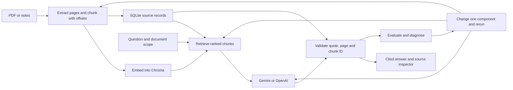

# Grasp

**A RAG study workspace that answers from your lecture notes and shows the passage behind each answer.**

[Interactive RAG walkthrough](https://stanbang.github.io/Grasp/) · [Engineering case study](docs/rag-case-study.md) · [Figma prototypes](https://www.figma.com/design/LJok1ZuyYyd9wdEIP6AAqT) · [Run locally](#run)

Drop PDF, Markdown or TXT notes into Grasp. Ask a question, open its exact cited passage, and inspect how concepts connect across documents. The app includes saved conversations, scoped search, PDF previews, optional local OCR and mastery quizzes.

## Why RAG for students?

A plain LLM is convenient for a general explanation. Pasting a short excerpt is a sensible baseline for one note. Grasp is designed for repeated questions across course materials where an answer must use the right lecture’s wording and give students a page and quote they can verify. RAG retrieves relevant material from the student’s collection before the language model answers. That makes the answer easier to check, while adding an index to maintain and a retrieval stage that can miss evidence.

## How the system works



The **knowledge base** combines Chroma vectors and canonical SQLite source records. The **retriever** embeds a query, filters by selected document IDs and resolves ready-source chunks. The **generator** receives a bounded evidence set, produces a structured answer and can abstain. A citation must identify a retrieved chunk, match its page, and quote an exact substring. Source links also determine which concept nodes to highlight. Exact quotation establishes provenance. Answer correctness and claim support require separate checks.

## How I weighed cost, speed and quality

| Design choice | What it buys | Tradeoff |
| --- | --- | --- |
| Parse first, OCR textless PDF pages when enabled | Page-specific evidence with no OCR service | Scans add CPU time and recognition errors can affect evidence |
| Embed on import, persist locally | Reuse indexed notes for repeated questions | Live queries still need embeddings and a model change needs reindexing |
| Overlap chunks; retrieve five by default | Bounded prompt context with boundary coverage | Short chunks can split an explanation; wider context can add noise and tokens |
| Bounded follow-up context and explicit scope | Portable query behavior and student control | Ambiguous questions may need a rewrite; exact terms may need a sparse retrieval path |
| Structured generation and exact cite checks | Inspectable evidence and a bounded failure path | Validation can trigger a retry and still cannot prove every claim |
| Optional rerank experiment | Evaluates better ordering of an unchanged candidate set | Production remains on its baseline pending held-out evaluation |

I chose local Chroma and SQLite for reproducibility and a single-user workload. Gemini Flash Lite passed the live acceptance check, and LangChain keeps providers replaceable. Mock mode avoids calls during development. These are design choices and compatibility results. The benchmark measures retrieval latency and context characters, while billed cost, total answer latency and scale need their own measurement.

## How I evaluated and chose components

I tested retrieval separately from generation. The expanded benchmark compares two chunk policies and an experimental term-overlap rerank on **20 labelled questions across four public notes**. A match requires the expected document and an exact passage. Reranking holds the candidate set and query embedding fixed. These are the observed live Gemini embedding results at k=3.

| Chunk size / overlap | Ordering | Hit@3 | MRR@3 | Retrieval p95 | Mean context chars |
| --- | --- | ---: | ---: | ---: | ---: |
| 900 / 150 | App retriever order | 19/20 | 0.817 | 713.0 ms | 1814 |
| 900 / 150 | Term-overlap rerank | 20/20 | 0.917 | 713.1 ms | 1786 |
| 360 / 60 | App retriever order | 20/20 | 0.900 | 692.4 ms | 805 |
| 360 / 60 | Term-overlap rerank | 20/20 | 0.925 | 692.5 ms | 796 |

For “How should I check whether my recalled answer missed details?”, reranking moved the required passage into third place. Smaller chunks without reranking put it second. The smaller-chunk configurations found all 20 passages, with less text per prompt and more indexed chunks (18 versus 8). I kept the baseline defaults because the authored set is exploratory. I would re-run the comparison on held-out lectures, including hard paraphrases and unanswerable questions, before changing the app. Timings include provider network time; they exclude answer generation. Five explicit scope cases per configuration returned zero out-of-scope chunks. That verifies the test filter cases and is not a tenant-isolation claim.

The separate end-to-end Gemini check verified two cited answers, persisted follow-up context, one unsupported question that abstained and quiz grading. The OCR container check used one image-only PDF and generated a cited answer. The older three-chunk Hit@5 check remains a smoke test. See the [live retrieval rows](apps/web/public/about/results-live.json), [mock baseline](apps/web/public/about/results-mock.json), [gold questions](apps/api/eval/portfolio-questions.json), [live acceptance](docs/live-verification.json) and [OCR-to-answer check](docs/production-verification.json).

## How I would adapt and monitor it

Define a student task, label evidence, measure the baseline and diagnose the failing layer. Change one component at a time. If evidence is missing, test chunking, exact-term retrieval or hybrid fusion. If candidates are present but rank poorly, compare a reranker. If the correct passage arrives but the answer is wrong, grade claim support, prompt behavior and model choice. Consider bounded agents only for tasks that need multiple tools, and fine-tune only for a measured behavior gap.

Keep source IDs and offsets stable across components. Rebuild incompatible indexes side by side. Gate changes on held-out retrieval and answer quality, scoped access, latency and cost. Track stage-level p50/p95, token usage, retries, ingestion errors, unsupported questions and cost per supported answer. Keep source text and credentials out of telemetry. The current app has health checks, status events, request limits and optional owner-token access. A shared production service would also require tenant isolation, document-level authorization and a monitoring pipeline.

## Interview demo

1. Open the [interactive walkthrough](https://stanbang.github.io/Grasp/) and click **Retrieve** and **Verify and cite** in the pipeline.
2. Change the retrieval configuration, then inspect a question’s gold quote and returned chunk IDs.
3. Try the prototype’s citation and unsupported-question paths. Use the [Figma frames and talking points](docs/rag-case-study.md#interview-walkthrough) to explain how source checking shaped the UI.
4. Open the local app to show real ingestion, the Three.js document orbit and the knowledge graph. In the live app, **About Grasp** opens the walkthrough without disturbing the current study session.

## Run

Install Python 3.11 and Node.js 20.19+ or 22.12+, then run:

```sh
python scripts/dev.py --setup
```

On Windows with multiple Python versions, use `py -3.11 scripts/dev.py --setup`. Open [the local workspace](http://127.0.0.1:5173). The default mock mode requires no key and returns retrieved excerpts. For local Docker with optional native OCR, use `docker compose up --build -d` and open [port 8080](http://127.0.0.1:8080/). The static case study is at `/about/index.html`.

Keep keys in the root `.env`. Set `MOCK_LLM=0`, choose a supported provider and configure its model, embeddings and key using `.env.example`. Live indexing and chat send text to the configured provider. Keep separate study data or reindex when switching embeddings. [Deployment guide](docs/deployment.md)

```sh
python scripts/check.py
npm run build
python apps/api/eval/portfolio.py --output work/portfolio-mock.json
```

The benchmark also accepts `--live` for a paid embedding run on the public fixtures. [Engineering details and interview responses](docs/rag-case-study.md) · [Architecture](docs/architecture.md) · [API contracts](docs/schemas.md) · [Workspace redesign](docs/redesign/delivery.md)
