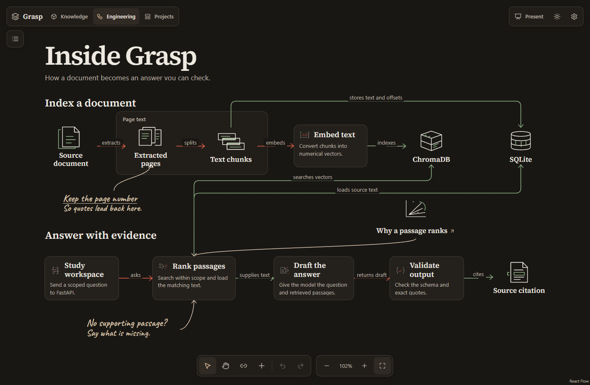
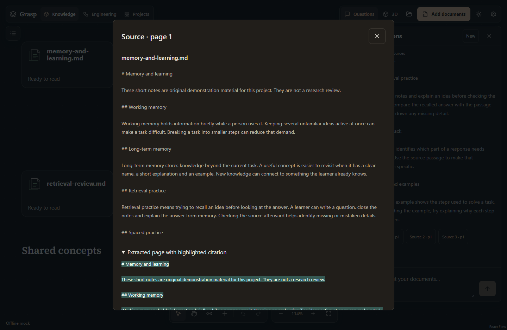
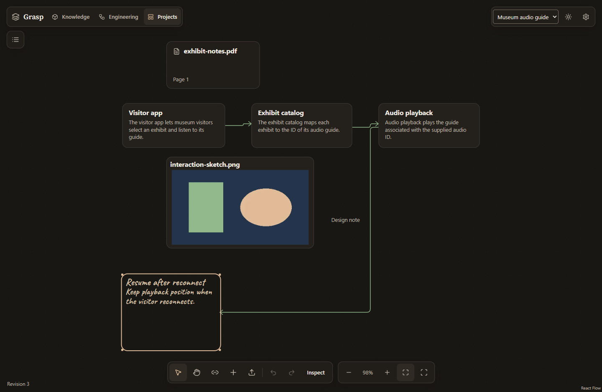
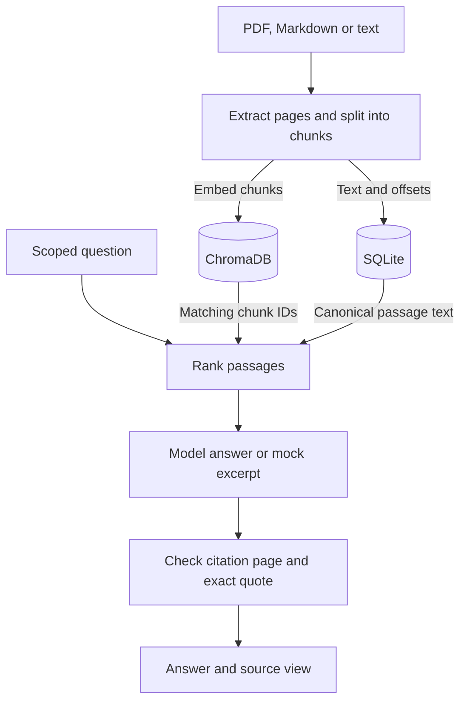
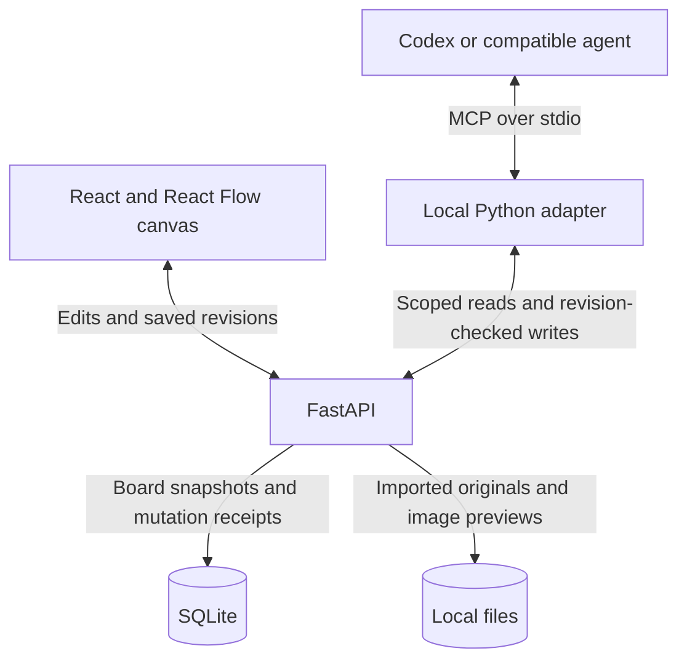

<p></p>

# GRASP

A retrieval-grounded visual workspace for understanding and designing software with AI agents.

**Developer preview · Milestone A**

[Quick start](#quick-start) · [Screenshots](#workspaces) · [Architecture](#architecture) · [Evaluation](#retrieval-evaluation)

GRASP started with a question about document Q&A. How can a reader see which passage supports an answer? It now brings that same link to evidence into a shared visual workspace where someone can explain a system, sketch a design and revise it with a coding agent.

## Workspaces

| Workspace | What you can do |
| --- | --- |
| **Knowledge** | Import PDF, Markdown or UTF-8 text, ask scoped questions and open exact source passages. Explore related concepts in 2D or 3D. |
| **Engineering** | Walk through GRASP’s own indexing, retrieval and citation pipeline. Open an example that shows how vector similarity affects the order of passages. |
| **Projects** | Create persistent boards with components, connections and notes. Import images and documents as board objects. Let a local coding agent read selection context and propose or apply edits over MCP. |



*Engineering follows both paths through the same pipeline. Page text and offsets stay in SQLite, and ChromaDB indexes the chunk vectors.*

<table>
  <tr>
    <td width="50%"><a href="docs/assets/preview-knowledge.webp"></a></td>
    <td width="50%"><a href="docs/assets/preview-project.webp"></a></td>
  </tr>
  <tr>
    <td><strong>Knowledge.</strong> A cited answer and its source in the bundled sample.</td>
    <td><strong>Projects.</strong> Codex built this board over MCP and added the playback note after the image and PDF were imported through the browser.</td>
  </tr>
</table>

All three screenshots come from the running app with bundled or synthetic data. The Projects example used the signed-in Codex CLI against a disposable local GRASP library.

<details>
<summary>Recorded RAG walkthrough</summary>


The browser-only showcase replays bundled example traces. It answers sample questions from recorded passages without a model connection. Run it locally at [`/showcase/`](http://127.0.0.1:5173/showcase/) or open the [RAG guide](http://127.0.0.1:5173/showcase/?view=guide).

</details>

## Quick start

Install Git, Python 3.11 and Node.js 22.12 or newer. Setup downloads dependencies. The default workspace runs locally without model API keys.

```sh
git clone https://github.com/stanbang/Grasp.git
cd Grasp
python scripts/dev.py --setup
```

On Windows, use `py -3.11 scripts/dev.py --setup` if `python` resolves to a different version. Open [GRASP on port 5173](http://127.0.0.1:5173/) while the command runs. Later starts use `python scripts/dev.py`. Press Ctrl+C to stop both servers. If a port is in use, edit `WEB_PORT` and `API_PORT` in the checkout’s `.env` and use the addresses printed at startup.

1. In **Knowledge**, select **Open sample**, then **Questions**. Ask “What is retrieval practice?” and open **Source 1** to check the quoted passage.
2. In **Engineering**, follow the indexing and answering paths. Select **Why a passage ranks** to explore the similarity example.
3. In **Projects**, enter a board name and select **Create board**. Add a component or note, connect it to another item and use **Import files** to place an image or document. Reload to see the saved board.

The default `MOCK_LLM=1` uses deterministic local embeddings and returns retrieved excerpts. To try live generation and embeddings with OpenAI or Gemini, configure the ignored root `.env`. Live mode sends document text to the configured provider for embedding and generation. Optional OCR for scanned PDFs uses local Tesseract and Poppler. [Configuration template](.env.example) · [Deployment and OCR](docs/deployment.md)

### Connect Codex

This setup is optional for the local walkthrough. To connect an installed Codex client on Windows, run these commands from the checkout in PowerShell.

```powershell
py -3.11 -m venv .venv-mcp
.\.venv-mcp\Scripts\python.exe -m pip install -e .\apps\agent
.\.venv-mcp\Scripts\grasp.exe setup --agent codex
```

Setup registers the MCP server and skill with Codex and stores separate owner and agent credentials in the ignored `.env`. Start or restart GRASP, run `.\.venv-mcp\Scripts\grasp.exe doctor`, then open a fresh local Codex chat. Ask it to sketch a system on a GRASP board. Select a component in the browser, then ask Codex to explain it or add a related note. Enter the owner credential in GRASP when it prompts for one. [Adapter installation and walkthrough](docs/grasp-v2/agent-guide.md)

## Architecture

### Document retrieval and citations



GRASP extracts text page by page and can use local OCR for scanned PDFs. It embeds text chunks with LangChain and uses ChromaDB to rank them within the selected document scope. In live mode, the model drafts a structured answer from the retrieved passages. FastAPI validates the response with Pydantic and checks cited quotes against the stored text. The concept map links to the same chunks so readers can explore related ideas. When retrieval finds no supporting passage, the API can decline to answer. [RAG design and code map](docs/rag-design.md)

### Shared project boards



Both clients work on the same saved board. An edit batch identifies its base revision and mutation ID. The API detects stale writes and recognizes retries. The browser keeps the user’s draft when a write conflicts. The API checks source and board asset access using a separate agent credential. [Canvas service and contracts](docs/grasp-v2/phase-2.md) · [Asset storage and sharing](docs/grasp-v2/milestone-a-assets.md)

The client uses React, TypeScript, Vite, Tailwind CSS, React Flow and Three.js. The backend uses Python, FastAPI, Pydantic, SQLModel, SQLite, ChromaDB and LangChain.

## Retrieval evaluation

In the archived Gemini embedding run, vector search ranked the labelled evidence first for **14 of 20 questions**. Reordering the same candidates by term overlap raised that to **17 of 20**. The questions cover four notes. This small experiment measured retrieval ranking. Generated answer quality still needs a separate evaluation. The workspace uses the baseline retriever. [Method, results and limitations](docs/evaluation.md)

## Verify locally

After setup, run the contract, API, frontend and build checks from the repository root.

```sh
python scripts/check.py
npm run build
```

The [Milestone A acceptance guide](docs/grasp-v2/milestone-a-assets.md) covers browser import, PDF page links, access grants, and the optional Codex CLI check.

## Preview scope

This is a local, single-owner workspace. Milestone A implements image and document assets on Project boards. The agent can read image metadata when the owner shares an asset on that board. Manual acceptance is pending. Image interpretation, contextual multimodal retrieval and evidence on diagram arrows are planned work. [Milestone A details](docs/grasp-v2/milestone-a-assets.md) · [Roadmap](docs/grasp-v2/roadmap.md)

## Demo script

1. Open [the recorded showcase](http://127.0.0.1:5173/showcase/) and select **How Grasp works**. Follow one networking question through the pipeline.
2. Return to the replay and select **Computer networks**. Pause on **Find passage boundaries** to show offsets and overlap, then finish the replay.
3. Ask “What does a router do?” and open **Page 1** to check the excerpt. Compare the baseline and the term-overlap experiment in the [evaluation](docs/evaluation.md).

## Repository guide

| Path | Contents |
| --- | --- |
| [`apps/web`](apps/web/) | Browser workspaces and recorded showcase |
| [`apps/api`](apps/api/) | Ingestion, retrieval, source citations, project storage and tests |
| [`apps/agent`](apps/agent/) | Local CLI and MCP adapter |
| [`samples`](samples/) | Bundled demo notes |
| [`docs`](docs/) | Design decisions, experiments and acceptance notes |

[Course walkthrough](docs/course-walkthrough.md) · [Retrieval tradeoffs](docs/tradeoffs.md) · [Interview talk track](docs/interview-talk-track.md)

## Author

Stanley Lur · Computer Science (Real-Time Interactive Simulation). [Portfolio](https://www.stanleylur.com/) · [GitHub](https://github.com/stanbang)
