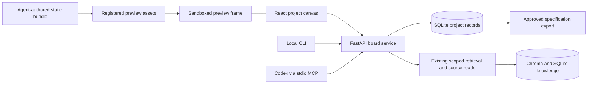
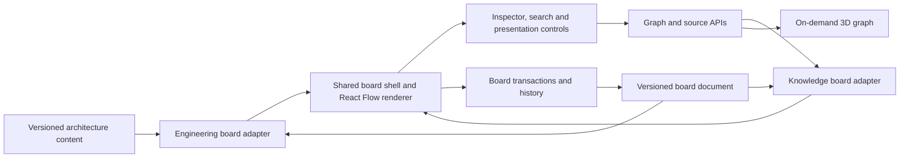

# Shared canvas architecture

The [Developer Preview service](#developer-preview-service) is the proposed architecture for the revised roadmap. The earlier canvas research below records the decisions that informed the approved whiteboard. Where a proposed contract or phase number differs, follow the Developer Preview plan.

## Developer Preview service

Phase 2 implements the Project board service, persistence, revision receipts and browser synchronization. The design below also describes later work on approval, selection and prototypes. [Phase 2 service contract](phase-2.md#http-contract-for-phase-3)

The project board API runs inside the existing FastAPI process and uses the existing SQLite engine. Start with versioned JSON board snapshots and immutable approvals. Keep the live editor and CLI or MCP adapter on the same routes. Keep the separate Knowledge and Engineering projections and the static showcase available throughout the migration.

### Data ownership

| Domain | Minimal durable representation |
| --- | --- |
| Project and board | Server-assigned `projectId`, `boardId`, title, schema version, monotonic revision, object and edge maps keyed by stable IDs. A project begins with one board. |
| Presentation objects | Authored type, finite world geometry, content and explicit references. Edges join two objects on the same board. The existing seed adapters still derive study and engineering visuals from their own sources. |
| Questions and requirements | Stable record IDs, unresolved or resolved status, linked board object or step, answer or decision, server-attributed author, approval relevance and source handles when applicable. Keep the question and the accepted requirement readable together. |
| Proposals and notes | Agent-proposed and user-authored content with explicit attribution. A project annotation can point to an object or prototype region. Proposals remain draft until the user approves a revision. |
| Prototype | Stable object ID with immutable revision metadata, registered preview ID, relative entry point, content digest and related requirements. Feedback references both object ID and the exact prototype revision. |
| Approval and export | Immutable `approvalId`, board ID, approved revision, schema version, requirement and decision records, explicit assumptions and exclusions, accepted prototype digest, evidence references and acceptance criteria. Export is JSON returned from the server. Later edits leave earlier approvals readable. |
| Canonical knowledge | Existing documents, graph IDs, source spans, conversations and mastery remain in their current schemas. Project evidence stores an authorized stable handle. Keep text quoted from canonical data at read or approval time and disclose missing sources. |
| Session | Camera, hover, gesture state, draft geometry and undo UI remain client-side. The browser may publish expiring object selection for the active project. Selection expires and cannot advance the saved revision. |

For the preview, add one board snapshot table, one mutation receipt table and one approval snapshot table. Keep related draft records and prototype metadata in the bounded board snapshot. Build a typed versioned read model and generate TypeScript using the existing generator. Add tables without changing existing study rows. Check a fresh and a copied database. There is no persisted Phase 1.1 board state to migrate. Test that the earlier workspace still opens and can ingest and answer after the new tables are initialized.

### Transactions and authoring

- `GET /boards`, `POST /boards` and `GET /boards/{boardId}` expose durable project boards. `POST /boards/{boardId}/ops` is the write boundary. Use the same operation semantics for browser, CLI and MCP. Names are proposed until Phase 2 approval.
- Start with typed batches for add/edit/move/resize/remove, links and annotations. Add requirements and decision operations before prototype registration. Validate operation type, geometry, counts, text sizes, references, board ownership, scope, actor permissions and evidence spans before writing. Reject unknown kinds and missing or cross-board references.
- Require `baseRevision` and a unique `mutationId`. In one SQLite transaction check for a matching receipt, compare the stored revision, validate the proposed state and write the new snapshot and receipt. Repeating the same request returns its exact commit receipt even when the board has advanced. A different payload under the same ID fails. A stale write returns `409` with the current revision. A rejected batch changes zero records.
- Keep local drag feedback immediate. Send one batch when the drag finishes and show save or conflict status. Preserve a rejected draft for comparison. Treat undo after save as a new validated inverse operation against the current revision. Keep local camera and selection across a reload where available without sharing them in exports.
- Give the browser owner a workspace credential and Codex a separate local agent capability for scoped reads and draft mutations. The server derives actor attribution from the credential. It enforces human-only answer resolution and approval directly on the service. Local bind and origin checks complement credential checking. The MCP process receives no general shell or network method through board tools.
- Approve via an explicit browser action against the exact revision. Reject approval when required questions are unresolved or referenced prototype/evidence fails validation. Freeze the snapshot, retain prior approval IDs, and show later edits as a new draft. Export an approved snapshot by ID without consulting mutable draft state.

### Context and verification

Reuse `retrieve_chunks` with an explicit, authorized set of document IDs. If the scope is empty, the project route returns a no-source result before it calls the existing retrieval function. Return real rank order and stable references. Exact source view resolves from stored text and keeps the existing one-based page and Unicode code-point offset semantics. Evidence carries no privileged instructions and cannot write canonical knowledge.

The agent adapter uses stdio with Codex and sends HTTP requests with its scoped token only to the configured loopback API endpoint. Serve prototype code from a dedicated origin, with no access to API credentials. Verify the [preview isolation requirements](developer-preview.md#prototype-workflow) before enabling the iframe.

## Earlier canvas architecture

### Responsibilities and identity

| Layer | Owns |
| --- | --- |
| Knowledge domain | Existing graph node and edge IDs, `docIds`, `sourceChunkIds`, mastery, documents, exact pages, citations and saved conversations. Only existing domain services may write these records. |
| Engineering content | Versioned repository-authored architecture node IDs, descriptions, typed relations, run mode, and source references. A source reference includes path, commit and optional line or symbol, or a named report and evidence status. |
| Board document | Board/workspace identity, object instances, user content, world geometry, presentation arrows, regions, frames, navigation links and revision. Multiple object instances can refer to one canonical concept. |
| Session and renderer | Selection by board object ID, pointer capture, draft geometry, hover, current camera and focused panel. React Flow receives derived nodes and edges. Selection, measurements and force simulation positions stay transient. |
| Operation and history | A validated board transaction changes the board document. A single finished gesture or approved AI batch produces one revision and undo unit. Persist the approved board delta or snapshot. In-memory undo history can reset on reload for the first release. |

A knowledge view initially materializes a deterministic overview of documents and selected concept neighborhoods. Use a stable order and seed positions so a refresh does not shuffle the map. Preserve saved placements when new nodes appear. A generated link carries its canonical edge ID and existing `docIds`. Link directly to source passages only where source provenance can be established. A user or AI visual connector is a presentation edge with its own ID and origin. Archived or missing bindings stay visible as unavailable and can be removed or relinked. Never rematch stale references by label or silently reuse an old citation after replacement. The optional 3D view consumes the canonical graph and receives the selected canonical node, while its camera and force coordinates are transient.

Engineering uses the same board, selection, search, camera, frame and inspector primitives. Its default seed is repository versioned. Edits create an editable board copy. Source-backed claims remain derived from the seed or an explicitly revised, versioned content record. Personal notes are visibly separate from architecture evidence.

### Camera and interaction

- Use one affine camera in CSS pixels for the usable board rectangle. With viewport translation `tx,ty`, zoom `z` and pane client origin `L,T`, world coordinates are `((clientX-L-tx)/z, (clientY-T-ty)/z)`. The inverse uses the same pane origin. At a zoom change keep the world point under the cursor fixed by solving the new translation from that point. Let React Flow handle its viewport math and use `screenToFlowPosition` at the boundary. A second subtraction would shift drops when panels open.
- Persist stable world geometry. Store groups in the same world coordinate space as their member bounds and derive the parent-relative positions React Flow expects. Reparenting and ungrouping preserve world positions. Track drag from pointer start to commit, roll back on cancel, and restore focus after dialogs close. Keep undo independent of camera navigation.
- Fit uses the visible pane after reserved panels, safe inset and padding. Calculate bounds from valid measured items. Empty selection keeps the camera, with an explicit **Fit board** action. Frame navigation stores `frameId`, fits its world rect with stable padding and cancels on user pan. Reduced motion jumps to the target. Back from a subboard, 3D or the demo restores board, frame, camera and available selection.
- Prefer typed orthogonal connections for technical flow and simple curves for concepts. Show arrows where direction matters. Place concise labels on a backing with enough clearance, with full relation text reachable from the inspector and outline. Custom card controls prevent pan or drag when interacting with content. Keep freehand points in world coordinates and cap length, bounds and point count.

### Proposed contracts and storage

These names and payloads are proposals. Implement Pydantic models and regenerate TypeScript only after the applicable phase approval. Existing generated schemas, identifiers, user data, mastery and citation semantics remain the compatibility baseline.

| Shape | Fields and invariants |
| --- | --- |
| `BoardDocumentV1` | `schemaVersion: 1`, `id`, server-bound workspace ID, `kind: engineering | knowledge`, title, monotonic `revision`, objects, connections, regions and ordered frames. Stored as a bounded versioned document with primary key and workspace ownership metadata in SQLite. |
| `BoardObject` | Opaque instance ID, discriminated type (`concept`, `document`, `component`, `note`, `stroke`, `portal`), finite bounded world rectangle, optional group ID and typed binding. Only note/annotation and other authored fields carry editable content. Provide provenance kind (`repository`, `semantic`, `user`, `aiProposal`), derived and verified at the appropriate boundary. |
| `BoardConnection`, `Region`, `PresentationFrame` | Connections reference two existing object IDs and carry a label and optional semantic edge binding. Regions name member IDs. Frames have stable ID, title, world bounds and optional target object. Presenter notes use a distinct display surface. Portals may reference another board in the same workspace and use bounded back navigation. |
| `BoardWrite` | Full versioned snapshot plus `baseRevision` and unique client mutation ID initially. Proposed `GET /boards/{boardId}`, `PUT /boards/{boardId}` and minimal list/create for approved user-created boards. Compare and swap atomically. A stale revision gives `409` and the current revision. Repeating the same mutation and payload returns its committed result. A mutation ID with a different body fails. Return only authorized board state. |
| `CanvasProposalV1` | Version, proposal ID, board ID, base revision, bounded discriminated operations and validated evidence refs. Operations add/move/update authorized presentation objects, link/group objects, create a subboard or highlight evidence. Preview a semantic diff. Apply the accepted list atomically under the same permission and revision check, with current graph/source references revalidated. |
| `PipelineObservationV1` | Optional additive, opt-in instrumented response or stream with run ID, type, source mode, stable stage name/status, safe counters and evidence IDs. Duration is optional, measured around real work. Keep this surface separate from existing chat response and ingestion event schemas. |

Phase 1 keeps edits session-local. In Phase 3, introduce an explicit versioned migration for the board store. Test it against a copy of a v1 database and an empty database. Avoid changing current rows and back up SQLite, Chroma and uploads together. Use one serialized write per board, debounce a finished edit, preserve an unsaved draft on failure, and offer reload or compare when a revision is stale. Do not apply silent last-writer-wins. Keep the last viewport as a local per-board preference if useful. A presentation frame is deliberate board content, so its bounds persist with the board. Engineering seed content can load from the build without a model request.

### Real observability and grounded AI

The existing ingestion stream reports queued/chunking/extracting batch progress, nodes, edges, complete and error. Use these events as recorded, with the existing replay cursor and terminal semantics. Do not imply separate OCR, embed, index or validation phases from a coarse event. Phase 4 can add safe spans around actual work and indicate skipped, measured or unavailable. Read pages and chunks once committed. Embedding model identity or dimension may be displayed when recorded. Never expose raw vectors, provider keys, private prompts or arbitrary document snippets in telemetry.

Instrument the existing retrieval path around query embedding/search, committed SQLite resolution, grounded generation and validation. If the adapter cannot distinguish substeps, show the combined stage. Display rank in committed retrieval order. Distances only appear when the actual path supplies a named metric and its direction. Citation provenance, retrieval relevance and claim support are separate checks. Ask through the existing route until an additive trace contract is approved.

Selection initially suggests a visible source scope from selected concepts' provenance. The user can confirm or adjust it, and stale or empty scoped selection requires a visible recovery path. Never broaden it silently to all documents. Personal or model-authored notes stay outside the trusted corpus. Support explicit broader lookup later without coupling board geometry to retrieval.

Validate AI output with Pydantic and the existing structured-output path. Treat evidence as untrusted text. Accept no executable content, unknown operation types, external file references or canonical graph edits. Check object types, finite geometry, limits, evidence membership, workspace, board revision and ownership again at apply time. If grouping and new child-board creation cross records, commit the approved batch in one database transaction. Record the operations and their inverse for undo. A generated idea with no matching source is labeled as a suggestion, never inserted as canonical knowledge. A declined or invalid proposal leaves storage untouched.
