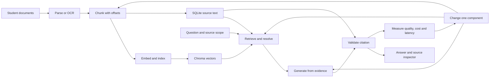

# Grasp as a RAG system

Grasp is a workspace for students who need to ask questions about their own notes, reconnect concepts across lectures and verify the evidence before relying on an answer.

## How I designed it for students

A student may want three different things: a general explanation, an answer using their course’s terminology, or a way to verify what a lecture actually says. A plain LLM is a good choice for the first task. For a one-off question about a short note, pasting the whole note into the prompt is simpler. I chose RAG for repeated questions across multiple files, where students benefit from explicit source scope and a way to jump to the exact page and quote. Indexing adds ingestion time and introduces retrieval errors. If the relevant passage never reaches the model, generation cannot reliably recover it. I have not run a controlled answer-quality comparison against a plain LLM or full-context prompting.

I started with the three responsibilities of a minimal RAG system:

- **Knowledge base.** The student’s PDFs, Markdown and TXT files are parsed into page text. Optional native OCR handles textless PDF pages. Recursive splitting stores document ID, page, chunk ID and page-local offsets. Persistent Chroma stores embeddings; SQLite holds canonical text, graph provenance and saved conversations.
- **Retriever.** At question time, embed the query and find similar chunks, optionally filtered to a document chosen by the student. Resolve results to stored, ready documents. A follow-up heuristic can prepend up to two earlier questions to retrieval text. Up to six recent turns can be supplied to the generator as context. This is a bounded heuristic, with no learned query planner.
- **Generator.** Pass the question and evidence to Gemini or OpenAI through one LangChain adapter. Request structured citations and abstention for unsupported questions. Validate chunk membership, document ID, page and exact quote, and retry invalid structured output once. UI graph highlights are derived from the retrieved chunks. The model never chooses arbitrary graph identifiers.

The workflow evolved from a question box over a graph into a document workspace with upload progress, a retained orbit, a separate knowledge view and an adjacent inspector. Keeping source selection distinct from question scope lets a student browse without silently changing the retrieval corpus. The cited quote is readable even when the browser cannot display the original PDF.

## Cost, speed and quality decisions

| Component | Choice and rationale | Tradeoff and trigger to revisit |
| --- | --- | --- |
| Parse | Local text extraction, with OCR available for pages with no text. Preserve page and exact character offsets. | OCR adds CPU time and may misread scans or equations. Compare OCR accuracy and indexing time on representative handouts. |
| Chunk | Recursive splitting, 900 characters with 150 overlap by default. Overlap helps keep evidence at boundaries. | Smaller chunks make evidence more focused and can split definitions or increase index size. Compare on fixed cases and evaluate context size. |
| Embed and store | Embed chunks at import. Persistent local Chroma supports similarity search and metadata filters without adding a hosted vector DB. SQLite keeps source records authoritative. | Each query still incurs an embedding call in live mode. Local storage is easy to reproduce for one student. Scale, concurrency and tenancy need measurement before a migration. |
| Retrieve | Limit to five chunks by default. Query and scope are explicit. Begin with one similarity search and inspect candidate ranks. | More candidates may improve coverage and inflate cost or distract the generator. Exact codes and course vocabulary may benefit from BM25 or reciprocal rank fusion. A cross-encoder adds latency in exchange for better ordering. |
| Generate | Gemini Flash Lite passed the live acceptance check. LangChain isolates provider choice. Mock mode keeps developer tests offline. | This is compatibility and bounded-call reasoning, not a claim of cheapest or fastest provider. Benchmark the same prompts and context across candidates. Two attempts are possible when validation fails. |
| Verify | Check exact source membership, page and quote before presenting a citation. Allow an unsupported response. | A sourced quote can still fail to entail the model’s claim. Review claim support, answer relevance and abstention independently. |

Cost model: track ingestion embeddings and extraction separately from per-question embedding, generation tokens and retries. Context characters are a prompt-size proxy. Convert recorded input and output tokens to cost using the selected provider’s current rates. I did not record billed cost or compare provider prices. Measure end-to-end p50/p95, retrieval p50/p95, generation p50/p95 and time to first visible feedback separately. The current app returns a complete chat response; upload progress streams through real server events.

Agentic retrieval could be justified for questions that require multiple searches or tools. It adds calls, permissions and failure paths. Fine-tuning can improve response style or structured output behavior, but changing a lecture should require updating its index rather than retraining a model. I would test each independently after identifying a specific failure in the baseline.

## How I evaluated it

### Component checks

The automated suite covers exact offsets, duplicate uploads, graph merging, schema retry, scope, structured response validation, saved conversation behavior, request limits, file-drop lifecycle and PDF previews. Native OCR was exercised in a local container using an image-only PDF. The existing 20-question sample report has three chunks, so Hit@5 mostly checks that indexing and retrieval are wired correctly. It is not the headline metric.

For the showcase benchmark I used **20 labelled questions across four public notes**, including related terminology in unrelated topics. Each label pairs the expected document with an exact quote. A match requires both. I changed two independent choices (chunk policy and ordering). The rerank reuses the same eight candidates in each chunk policy and sorts by distinct exact term overlap. It adds no model call. The two indexes reuse the same questions and embedding model, but make separate query calls. Five questions use explicit document scope.

| Live Gemini configuration | Chunks | Hit@1 | Hit@3 | MRR@3 | Retrieval p95 | Mean top-3 characters |
| --- | ---: | ---: | ---: | ---: | ---: | ---: |
| 900/150, app retriever order | 8 | 0.70 | 0.95 | 0.817 | 713.0 ms | 1814 |
| 900/150, term-overlap rerank | 8 | 0.85 | 1.00 | 0.917 | 713.1 ms | 1786 |
| 360/60, app retriever order | 18 | 0.80 | 1.00 | 0.900 | 692.4 ms | 805 |
| 360/60, term-overlap rerank | 18 | 0.85 | 1.00 | 0.925 | 692.5 ms | 796 |

Hit@k counts questions with at least one gold match in the first k. MRR@3 averages inverse rank of the first gold match, using zero for misses. The report stores each question, ordered chunk IDs, first gold rank and timing. No scoped result crossed its selected document in these five scoped cases per run. That checks relevance filtering, not tenant security. Timings are warm retrieval wall time including the embedding call, without indexing or answer generation, on one machine and provider run. The mock mode uses deterministic hash vectors and an exact-term filter. It gives a reproducible development signal, so mock and live rankings are not a controlled embedding-only comparison.

The default chunk policy with reranking improved on the larger-chunk baseline. Smaller windows also improved the live retrieval result and reduced the evidence text sent downstream, while growing the index from 8 to 18 chunks. This authored sample is small and used to inspect configurations, with no held-out split. One of 20 cases is five percentage points. I kept the existing defaults and would validate both candidates on independent lecture weeks before choosing. I did not treat milliseconds from a single network run as a causal latency advantage.

- [Live retrieval report](../apps/web/public/about/results-live.json)
- [Offline fixture report](../apps/web/public/about/results-mock.json)
- [Gold questions](../apps/api/eval/portfolio-questions.json) and [runner](../apps/api/eval/portfolio.py)

```sh
python apps/api/eval/portfolio.py --output work/portfolio-mock.json
python apps/api/eval/portfolio.py --live --output work/portfolio-live.json
```

Use the project virtual environment. The second command sends the four public fixtures and test queries to the configured embedding provider. Temporary indexes keep the study library untouched.

### End-to-end acceptance

The separate live check exercised ingestion and concept extraction, two answers with exact citations (including a follow-up), persisted conversation turns, one unsupported question that abstained, and a generated three-question quiz. The container check also demonstrated native OCR followed by a cited Gemini answer and original PDF access. Those are acceptance checks. I would measure answer accuracy and claim support across a labelled held-out set before estimating rates. [Live check](live-verification.json) · [Container result](production-verification.json)

### Monitoring and release gates

| Signal | How to measure | Decision |
| --- | --- | --- |
| Ingestion health | Record parse, embed and index timings, failed jobs, retry counts, duplicate events and scan/OCR failures. | Investigate document families with errors before changing the model. |
| Retrieval | Replay scoped, paraphrased, exact-term and cross-source questions. Track Hit@k, MRR, citation page accuracy and metadata boundary violations. | Reject a release if scope is violated. Compare candidate changes on a held-out split. |
| Answer quality | Grade correctness, claim support, citation coverage and abstention on answerable and unanswerable questions. | Diagnose whether the evidence was missing, ranked too low or misused by the generator. |
| Latency and cost | Trace request ID, model version, stage duration, input/output tokens and number of calls. Use aggregates for p50/p95 and cost per supported answer. | Keep a stronger component when its quality gains justify the budget. |
| Security | Keep keys server-side, use upload/request limits and an optional owner token. Treat source text as untrusted. For multiple users, enforce authorization during retrieval, isolate tenant data and test cross-user requests. | Keep private prompts, passages and credentials out of telemetry and public demos. |

Grasp currently has API health checks, ingestion statuses and bounded mutation requests. This table describes the production measurement plan. It does not claim a telemetry service, multi-tenant readiness or formal safety guarantees.

## How I would adapt it



Start with the user task and label expected evidence. Run a baseline, inspect misses and change the layer responsible. Preserve stable source metadata so new retrieval and generation components still feed the inspector. When changing embeddings or chunking, build a separate index and evaluate it before switching. Rerun component checks and end-to-end cases with the same questions, then keep or roll back the change against pre-agreed quality, latency, privacy and cost requirements.

## Interview walkthrough

**60 seconds.** “I built Grasp because a student asking about a lecture needs the lecturer’s actual wording and an evidence trail. A general LLM would be my baseline for explanations. Grasp indexes the student’s files, retrieves passages within their selected scope and asks the model to answer with validated page citations. I evaluated retrieval independently from answer generation. On a small live four-note benchmark, the baseline hit 19 of 20 within three chunks. Reranking the same candidates reached 20 of 20. Smaller chunks also reached 20 of 20 and sent less source text, but created more indexed chunks. I kept the production default because the benchmark was exploratory. My next gate is a held-out set with unanswerable, cross-note and scope cases, while tracing latency and cost.”

**Show it in three minutes.** Start with [the interactive walkthrough](https://stanbang.github.io/Grasp/#pipeline). Click Retrieve and Verify to explain the split. In Evaluation switch between large chunks and the small-chunk run, then choose a question whose baseline missed. In Prototype open the exact quote and try the unsupported question. Open Grasp locally to show the real pipeline and student UI. The browser prototype is intentionally a scripted example one can show without keys, uploads or a local backend.

**Figma design story.** Walk from the [empty workspace](https://www.figma.com/design/LJok1ZuyYyd9wdEIP6AAqT?node-id=3-177) through [processing](https://www.figma.com/design/LJok1ZuyYyd9wdEIP6AAqT?node-id=3-272), [document orbit](https://www.figma.com/design/LJok1ZuyYyd9wdEIP6AAqT?node-id=3-348), [cited chat](https://www.figma.com/design/LJok1ZuyYyd9wdEIP6AAqT?node-id=3-489) and [inspection](https://www.figma.com/design/LJok1ZuyYyd9wdEIP6AAqT?node-id=3-635). Explain the decisions behind each move: discover file upload, make actual ingestion status visible, keep the student’s sources in view, show the evidence on each answer, and let users verify a passage without leaving the workspace. These editable frames show interaction design, separate from the benchmark UI.

**HTX connection.** “The same pattern applies to any approved internal knowledge workspace: a scoped source corpus, traceable evidence, an explicit abstention path and measured tradeoffs. For public-safety use, I’d require document-level authorization, review workflows and monitoring before deployment. Grasp is a student prototype that demonstrates the engineering pattern.”

## References

- [DeepLearning.AI RAG syllabus](https://www.coursera.org/learn/retrieval-augmented-generation-rag) frames the case study around architecture, retrieval, generation and production evaluation. The project evidence above comes from Grasp’s code and experiments.
- [Muhammad Raziq’s research paper Q&A case study](https://raziqqx.github.io/projects/research-rag-platform/) influenced the evidence-first presentation: link each reported metric to a result file, treat retrieval and answer quality separately, and spell out limitations. Its pgvector, hybrid retrieval, cross-encoder and abstention metrics describe that system and are not Grasp results.
